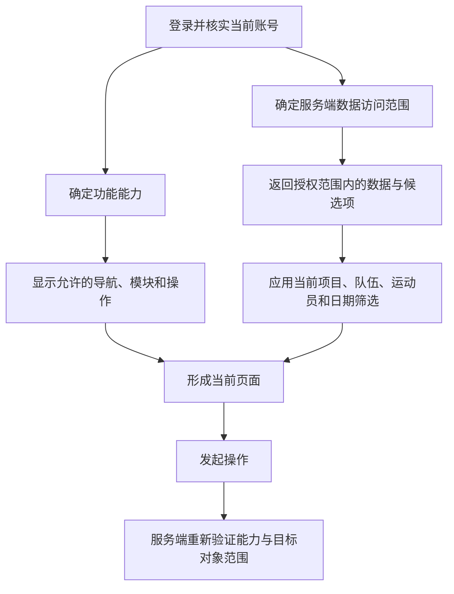

# 身份能力与页面展示统一设计 Spec

日期：2026-10-11

状态：待评审，尚未实施

适用端：网页端、微信小程序、业务 API

## 1. 目标与范围

统一不同身份进入系统后看到的功能、允许访问的数据和当前页面筛选行为，减少各页面重复判断角色造成的展示遗漏。保留 ATL、SCC、REG、TD、DMD 五类身份及现有账号授权范围。

本设计覆盖核心训练页面的能力声明、两端展示控制、服务端能力快照、权限刷新及回归验证。首批页面为训练总览、体能训练、专项训练和运动员档案。管理模块随后逐项迁移，不能通过一条“管理身份”规则推导所有操作权限。

不包含：自定义角色、可视化权限编辑器、新权限依赖、数据库权限模型重建、五套独立页面、全新管理驾驶舱。角色首页的信息重排属于后续独立产品设计，本期保持现有模块顺序与布局。

## 2. 用户应当理解的规则

系统依次回答三个问题：

1. **你是谁、能做什么？** 身份决定功能能力，例如本人填报、查看队伍待办。
2. **你能访问谁？** 服务端按本人归属或区域、项目、队伍授权限定数据。
3. **你现在看谁？** 页面筛选从已授权对象中选择具体队伍、运动员和日期。



页面筛选只能缩小数据范围，不能增加权限。前端隐藏控件不构成授权。

## 3. 当前代码基线

| 责任 | 当前位置 | 当前行为 |
| --- | --- | --- |
| 角色名称与等级 | `shared/access.ts` | 定义五类角色；管理目标角色要求自身等级严格更高 |
| 登录身份核验 | `server/core/auth.ts` | 验证凭证，读取当前启用账号并核验会话版本 |
| 数据范围 | `server/core/permissions.ts` | ATL 使用本人 athleteId；其他身份校验区域、项目、队伍 |
| 网页菜单 | `src/components/AppShell.tsx` | 按各菜单的角色数组过滤 |
| 网页页面装配 | `src/App.tsx` | 另有角色条件与默认运动员选择 |
| 小程序身份上下文 | `WeChat Mini Program/utils/context.js` | 获取身份、项目和已授权运动员，保留当前选择 |
| 小程序页面范围 | `WeChat Mini Program/utils/page-scope.js` | ATL 固定本人，控制运动员筛选器 |
| 小程序业务模块 | 各页面 JS / WXML | 使用角色数组、canSelfReport、canViewTodos、canEnterTest 等条件 |

近期已确认的展示要求：运动员登录后，体能训练与专项训练页面不展示运动员列表模块，包含标题、人数、搜索、人员行、档案入口、空状态和分页。

## 4. 必须保留的授权语义

### 4.1 身份与数据范围分离

| 身份 | 代码 | 数据访问规则 |
| --- | --- | --- |
| 运动员 | ATL | 仅绑定的本人运动员，项目来自本人归属 |
| 队伍体能教练 | SCC | 配置的区域、项目、队伍授权的交集 |
| 业务负责人 | REG | 配置的区域、项目、队伍授权的交集 |
| 训练总监 | TD | 配置的区域、项目、队伍授权的交集 |
| 数据监控总监 | DMD | 配置的区域、项目、队伍授权的交集 |

角色等级不能替代资源访问检查。DMD 不因角色名称自动取得全国或全项目权限。通配授权沿用现有语义，不在迁移时增加通配项。

账号管理仍需同时满足：操作人角色等级严格高于目标、操作人授权范围覆盖目标，以及对应接口已有的业务约束。

### 4.2 授权结果

- 未登录、账号停用或会话版本失效：沿用现有 401 和登录失效处理。
- 已登录但无操作能力：返回 403。
- 目标不在授权范围：沿用对应接口现有 403 / 404 语义，不能因此次迁移泄露目标是否存在。
- 空授权范围：返回合法空数据或拒绝操作，不能回退为全量数据。
- 三个项目的数据继续隔离；筛选参数、缓存或客户端能力均不能绕过项目检查。

## 5. 统一能力模型

### 5.1 首批能力矩阵

“允许”表示可进入对应功能，具体对象、绑定条件和业务规则仍需单独校验。

| 能力标识 | 含义 | ATL | SCC | REG | TD | DMD |
| --- | --- | --- | --- | --- | --- | --- |
| `viewOwnTraining` | 查看本人训练模式 | 允许 | — | — | — | — |
| `selfReportTraining` | 本人训练填报入口 | 允许 | — | — | — | — |
| `selfReportWellness` | 本人恢复填报入口 | 允许 | — | — | — | — |
| `viewAthleteList` | 查看已授权运动员列表 | — | 允许 | 允许 | 允许 | 允许 |
| `selectAthlete` | 在授权候选中选择运动员 | — | 允许 | 允许 | 允许 | 允许 |
| `viewTeamTodos` | 查看队伍客观待办 | — | 允许 | 允许 | 允许 | 允许 |
| `enterTest` | 进入测试录入流程 | — | 允许 | 允许 | 允许 | 允许 |
| `viewAuditLogs` | 查看操作日志 | — | — | — | — | 允许 |

`viewOwnTraining` 表示个人模式，不意味着管理身份不能查看某名授权运动员的训练。管理身份通过 selectAthlete 进入明细模式。

ATL 未绑定有效运动员时，不展示可用的本人写入入口，应提示“账号尚未关联有效运动员，请联系管理员”；服务端仍拒绝写入。能力本身不能充当绑定有效性证明。

账号管理、队伍管理、数据导入、指标标准修改等能力不在首批矩阵中推定。迁移前逐接口确认既有规则，再增加语义明确的能力；不得把菜单可见直接等同于所有操作可执行。

### 5.2 定义与依赖方向

- 新增 `shared/capabilities.ts`：能力标识、角色到基础能力的纯映射及查询函数，不依赖 HTTP、数据库或浏览器。
- `shared/access.ts` 继续负责角色名称与等级，不承担页面布局职责。
- 前端页面通过统一能力查询控制展示，不再新增散落的角色数组或角色否定条件。
- 小程序首阶段由 shared 纯定义生成本地能力字典；生成产物不可手工维护。第二阶段以服务端快照为运行时依据，本地字典仅提供已知标识与兼容支持。
- 未知角色、未知能力默认拒绝；未知快照字段不得触发权限放开。
- 能力不包含运动员 ID 清单，不复制服务端资源范围逻辑。

扩展字典生成脚本属于受保护路径，实现前必须取得该路径的明确授权。本 spec 的编写不等于授权修改脚本、认证代码或其他受保护路径。

## 6. 页面展示要求

### 6.1 小程序

保留训练总览、专项训练、体能训练、档案、我的五个底部入口。

| 页面 | 运动员 | 其他四类身份 |
| --- | --- | --- |
| 训练总览 | 本人模式，今日状态与本人填报；无队伍待办和人员管理区 | 授权范围汇总，可按现有控件筛选，显示队伍待办与人员区 |
| 体能训练 | 本人概览、训练安排与记录；无运动员列表和选择器 | 保留现有数据模块、授权运动员选择与列表 |
| 专项训练 | 本人专项数据和测试；无运动员列表 | 保留授权范围内的数据、筛选与运动员列表 |
| 档案 | 本人档案；操作遵循既有权限 | 所选授权运动员档案；具体编辑能力遵循既有权限 |
| 我的 | 当前账号、安全与隐私设置 | 当前账号、安全与隐私设置 |

`selectAthlete` 允许选择不代表每个页面必须提供选择器。例如专项页已有的筛选结构保持不变，不能因拥有该能力自动添加新控件。

模块关闭时必须同时移除标题、卡片、搜索、列表、空状态、分页及可聚焦入口。保留数据层为计算其他模块所需的授权数据；只有确认独立请求仅服务于隐藏模块时，才停止该请求。

### 6.2 网页端

- 菜单、页面入口和操作按钮使用统一能力含义。
- 首批只迁移对应训练页及相关入口；未迁移管理模块保留既有检查。
- 手动进入不可访问页面时，展示无权限说明与返回可访问页面的操作，不只隐藏侧栏。
- 数据范围与小程序一致，布局与信息密度可以不同。

### 6.3 状态呈现

- 身份确认中：展示加载状态，不闪现管理模块，不复用上一账号的数据。
- 无权限：说明不可访问，不伪装为“暂无数据”。
- 有权限但无记录：展示空状态。
- 请求失败：展示错误与重试；不能将错误解释为零值或权限允许。
- 人员模块隐藏后，相关按钮不得留在焦点顺序中。

## 7. 服务端能力快照与刷新

第二阶段扩展现有登录响应和 `GET /api/me`，以新增字段返回相同结构的能力快照。保留现有字段，兼容旧客户端。

建议新增结构如下，实际实现须使用边界 schema 校验：

```json
{
  "capabilities": {
    "schemaVersion": 1,
    "abilities": ["viewOwnTraining", "selfReportTraining", "selfReportWellness"]
  }
}
```

schemaVersion 表示响应结构版本，不是账号权限修订号。服务端根据当前已核实账号计算快照；客户端不得提交快照作为授权依据。服务端对每次业务请求继续独立验证能力、资源范围和业务约束。

刷新规则：

1. 登录成功后应用身份及能力，随后加载项目和授权候选。
2. 前台恢复或页面进入时，身份快照超过 60 秒则先刷新；有效期内允许复用。业务数据缓存可以更短。
3. 改权操作完成后，操作端使自身相关候选缓存失效；被修改账号下次进入页面或恢复前台时按上述期限刷新。服务端权限不等待客户端刷新才生效。
4. 业务请求返回 403 时，最多触发一次身份与候选刷新，不自动重试写操作；若刷新后仍有功能能力，则提示目标超出范围或操作不被允许。
5. 401 进入已有登录失效流程并清理当前账号上下文。
6. 能力刷新失败时，不放开新功能；过期快照不继续开启写入入口，展示重试。候选刷新失败时清空失效选择，不以旧候选扩展范围。
7. 每次登录、退出及身份范围刷新均使旧请求结果失效，迟到响应不得覆盖新账号上下文。

第二阶段新客户端支持旧服务端：缺少 capabilities 时，通过已验证 user.role 和本地固定矩阵计算首批基础能力。显式空 abilities 表示没有能力，不能回退。未知 schemaVersion 或非法快照拒绝应用并提示刷新/升级，不能回退成全功能。

本期不新增权限版本数据库字段，不以长期缓存替代逐请求鉴权。

## 8. 筛选与缓存约束

- ATL 的目标始终由本人绑定决定，忽略客户端企图切换到其他运动员的选择。
- 管理身份的项目、队伍、运动员只能选服务端返回的授权候选。
- 项目切换后重新验证队伍和运动员归属；不合法选择清除，不沿用其他项目的数据。
- 权限缩小时清理已无权访问的明细、分页、汇总及缓存；仍合法的筛选可以保留。
- 切换账号后清理上一账号的业务上下文；离线草稿继续遵循现有按身份隔离规则，不自动删除用户未提交草稿。
- 既有请求竞争护栏继续生效，刷新身份与候选期间不能短暂显示其他身份内容。

## 9. 分阶段交付与回退

| 阶段 | 交付内容 | 验收门槛 |
| --- | --- | --- |
| 一：能力定义与核心页面 | 固定能力矩阵、纯查询函数、小程序同步字典、两端四个训练页面的展示迁移 | 原有接口授权行为不变，五类角色展示符合第 6 节 |
| 二：快照与上下文刷新 | 登录及 /api/me 增量字段、边界校验、刷新与缓存失效 | 新旧端兼容；改权、停用、切号与迟到响应场景通过 |
| 三：管理功能收敛 | 对管理功能逐接口盘点，再统一菜单、页面、按钮与服务端操作能力 | 每项操作均有已确认矩阵和越权回归，不能只验证菜单 |

首阶段不改服务端接口契约和既有授权结果；保留当前个人与队伍视角。阶段二、三涉及认证与授权路径，实施前需明确授权和安全审查。

每阶段独立提交。回退客户端或快照附加字段时继续保留原服务端范围校验；不得以移除权限检查作为兼容或回退手段。后续角色首页重排单独立项，不作为本 spec 的完成条件。

## 10. 验收场景

| 编号 | 场景 | 必须结果 |
| --- | --- | --- |
| A01 | ATL 进入体能与专项页 | 看本人数据，无运动员模块、搜索、人数、分页或残留空卡片 |
| A02 | SCC / REG / TD / DMD 进入上述页面 | 保留原有授权人员列表和操作能力，不增加范围 |
| A03 | ATL 手动传入其他 athleteId | 服务端拒绝或按既有本人接口忽略该参数，绝不返回他人数据 |
| A04 | 两个同角色账号授权不同队伍 | 功能可以相同，人员与汇总分别限于各自范围 |
| A05 | 高等级身份未获其他区域/项目授权 | 不能因等级高而访问未授权数据 |
| A06 | 项目切换、候选失效 | 清理不合法选择，旧请求不覆盖新项目内容 |
| A07 | 隐藏入口后手动进入或请求接口 | 页面明确处理无权限；接口独立拒绝越权操作 |
| A08 | ATL 缺少有效绑定 | 提示联系管理员，不产生本人写入或全员回退 |
| A09 | 快照缺失、空数组、未知版本、请求失败 | 分别执行第 7 节兼容/拒绝规则，无权限闪现 |
| A10 | 改权后仍使用旧页面 | 服务端立即按现权限检查；客户端按刷新规则清除失效内容 |
| A11 | 账号停用、退出、切换账号 | 旧会话失效或上下文清理，旧响应不能恢复前账号页面 |
| A12 | 加载、空记录、403、网络失败 | 四种状态有明确差异，不显示模拟值或误报零值 |
| A13 | 键盘/读屏检查 | 隐藏模块没有可聚焦残留，保留控件有名称和焦点提示 |

验证层级：纯能力映射使用现有 Vitest；服务端使用隔离测试库验证身份与范围；小程序沿用现有页面测试，并使用开发者工具与真机核实渲染；网页交互使用既有浏览器检查流程。未配置的测试层需要明确记录，不能用静态字符串断言证明真实渲染正确。

代码阶段至少运行 `npm run check`、`npm run mini:typecheck`、`npm run lint` 和受影响测试；生成字典变更补充 `npm run mini:dictionary-check`；构建、依赖或打包变化补充 `npm run build`。已知基线失败须单列，不能描述为全套通过。

## 11. 文档与完成条件

实施时同步更新 README 的角色可见功能和 `docs/architecture.md` 的能力、范围及快照责任边界。本 spec 是目标设计，不表示相关接口或能力文件已经存在。

完成条件：各阶段验收通过；新增能力只有一个纯定义源；两端首批页面没有独立的角色数组；服务端授权范围未放宽；权限刷新与兼容行为有测试证据；交付列明真机验证状态和剩余限制。

当前只交付 spec，等待评审。评审通过后再编写实施计划并执行，不在本轮修改业务代码或受保护路径。
